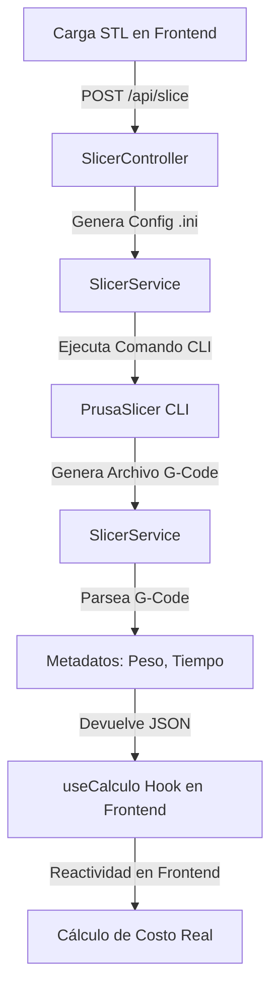

# 🔄 Flujos Operativos y Pipeline 3D

Este documento detalla el funcionamiento técnico del motor de procesamiento 3D y slicing de **Printly**, describiendo la interacción desde que el usuario sube un archivo STL hasta que se calcula el costo en tiempo real y se visualiza en la interfaz.

---

## 🚀 1. El Pipeline de Slicing (Integración PrusaSlicer)

Printly integra de forma local la herramienta **PrusaSlicer CLI** para procesar archivos 3D directamente en la computadora del usuario sin requerir APIs web externas.



### Flujo de Ejecución Detallado:

1.  **Carga e Ingesta**: El frontend envía el archivo `.stl` y los perfiles de impresora e impresión seleccionados al endpoint `/api/slice`.
2.  **Generación de Configuración Temp**: El backend (`PrusaSlicerGenerator.java`) lee los parámetros del perfil y escribe un archivo de configuración temporal `.ini` con los ajustes específicos de temperatura, rellenos, capas y soporte.
3.  **Ejecución Asíncrona del Comando CLI**:
    El backend lanza un subproceso llamando al ejecutable nativo de PrusaSlicer provisto en los binarios de la aplicación:
    ```powershell
    prusa-slicer.exe --slice --load temp_config.ini --output temp_output.gcode input_file.stl
    ```
4.  **Parseo de G-Code**:
    Una vez finalizada la ejecución de PrusaSlicer, el servicio lee el archivo `.gcode` generado. Parsea las líneas de metadatos al final del archivo insertadas por el slicer:
    *   `filament used [g]`: Peso exacto de filamento consumido.
    *   `filament cost`: Costo teórico.
    *   `estimated printing time`: Tiempo total de impresión en horas, minutos y segundos.
5.  **Retorno**: El backend elimina los archivos temporales generados (`.ini` y `.gcode`) y retorna la información limpia al frontend en formato JSON.

---

## 🧮 2. Reactividad y Cálculo Centralizado (Backend)

Anteriormente, el frontend calculaba los costos localmente. Por decisión arquitectónica, el motor de cálculo se centralizó en el **Backend (`CostCalculationService`)** para actuar como la única fuente de verdad, asegurando que todos los catálogos y lotes usen siempre las mismas variables globales.

### Flujo de Cálculo Dinámico:
1.  **Cotización Rápida**: El hook `useCalculo` en el frontend ahora envía los datos físicos (peso, tiempo) y el ID del material al endpoint `POST /api/v1/calculos/calculate`.
2.  **Transparencia de Costos**: El servidor responde con un desglose técnico puramente enfocado en la producción (Material, Energía, Insumos Extra). Se eliminaron conceptos comerciales (multiplicadores de venta y desgaste de máquina) de esta capa base para simplificar la contabilidad.
3.  **Fórmulas del Motor (Backend)**:
    *   `TiempoTotalHoras = Horas + (Minutos / 60)`
    *   `CostoEnergia = (ConsumoWatts / 1000) * TiempoTotalHoras * PrecioKwhGlobal`
    *   `CostoFilamento = (Gramos / 1000) * PrecioFilamentoKg`
    *   `Subtotal = CostoEnergia + CostoFilamento + InsumosExtra`
    *   `CostoBaseFinal = Subtotal * (1 + MargenErrorGlobal / 100)`

---

## 👁️ 3. Pipeline de Renderizado 3D

Para las tarjetas de la galería en la Biblioteca y el visor de detalle, la aplicación implementa previsualizaciones ligeras del modelo 3D cargado:
*   **React Three Fiber & Drei**: Se monta un canvas de WebGL liviano que lee el archivo STL convertido a Buffer.
*   **Optimizaciones de Carga**:
    *   Se calcula la caja de contención para centrar la cámara del canvas de forma automática.
    *   Se limita la complejidad de las geometrías en previsualización (se lee el STL binario simplificado) para evitar caídas de frames en el render del navegador embebido de Electron.
