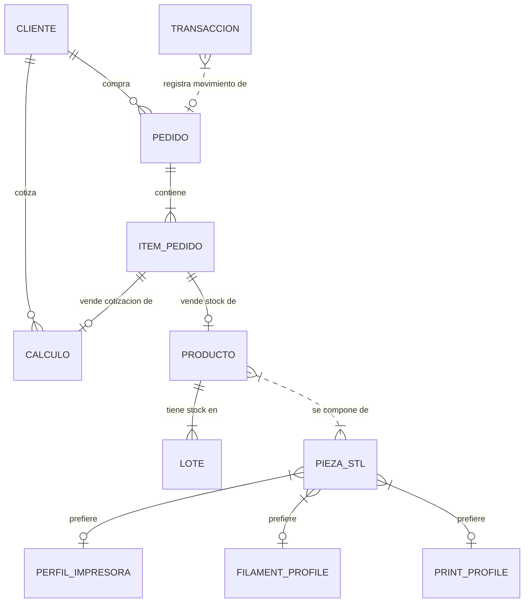

# 🗄️ Modelo de Datos y Relaciones entre Entidades

Este documento especifica de manera exhaustiva el esquema relacional de la base de datos SQLite de **PrintRM**, detallando el mapeo de relaciones JPA (Hibernate) entre todas las entidades del dominio de la aplicación.

---

## 🗺️ Mapa de Relaciones (Tabla de Entidades)

| Entidad Origen | Entidad Destino | Tipo Relación | Campo / Tabla Join (FK) | Comportamiento JPA (Cascade/Fetch/Opcionalidad) | Propósito / Descripción |
| :--- | :--- | :--- | :--- | :--- | :--- |
| **Pedido** | **Cliente** | `Many-to-One` | `cliente_id` | `FetchType.LAZY`, Opcional (Consumidor Final si es `null`) | Asocia una orden de compra a un cliente registrado en el CRM. |
| **Pedido** | **ItemPedido** | `One-to-Many` | `items` (mapeado por `pedido` en ItemPedido) | `CascadeType.ALL`, `orphanRemoval = true` | Agrupa las líneas de detalle de productos y cotizaciones que componen el pedido. |
| **ItemPedido** | **Pedido** | `Many-to-One` | `pedido_id` | `FetchType.LAZY`, No opcional | Apunta de vuelta al pedido contenedor de este ítem. |
| **ItemPedido** | **Producto** | `Many-to-One` | `producto_id` | `FetchType.LAZY`, Opcional | Si el ítem es un producto de stock ya registrado en el catálogo. |
| **ItemPedido** | **Calculo** | `Many-to-One` | `calculo_id` | `FetchType.LAZY`, Opcional | Si el ítem es una cotización directa a partir de un archivo STL. |
| **Producto** | **Lote** | `One-to-Many` | `lotes` (mapeado por `producto` en Lote) | `CascadeType.ALL`, `orphanRemoval = true` | Agrupa los lotes de stock con diferentes costos unitarios para consumo FIFO. |
| **Producto** | **PiezaSTL** | `Many-to-Many` | Tabla Join: `producto_partes` (FKs: `producto_id`, `pieza_id`) | Sin cascada de borrado. | Relaciona los modelos 3D que componen un producto final en el catálogo. |
| **Lote** | **Producto** | `Many-to-One` | `producto_id` | `FetchType.LAZY`, No opcional | Vincula el lote de stock físico a su respectivo producto del catálogo. |
| **PiezaSTL** | **Perfil** (Impresora)| `Many-to-One` | `perfil_impresora_id` | Opcional | Perfil de impresora preferido para fabricar esta pieza. |
| **PiezaSTL** | **FilamentProfile** | `Many-to-One` | `perfil_filamento_id` | Opcional | Perfil de filamento preferido para fabricar esta pieza. |
| **PiezaSTL** | **PrintProfile** | `Many-to-One` | `perfil_impresion_id` | Opcional | Ajustes de resolución y relleno preferidos para la pieza. |
| **Calculo** | **Cliente** | `Many-to-One` | `cliente_id` | `FetchType.LAZY`, Opcional | Asocia opcionalmente una cotización/cálculo a un cliente específico. |
| **Transaccion** | **Pedido** | Relación lógica | `pedidoId` (Referencia suelta por UUID) | No acoplado a nivel JPA. Persistencia independiente. | Vincula un movimiento del libro diario al pedido que lo originó. |

---

## 📂 Esquema Relacional de Campos (Notación Estándar)

A continuación se detallan los esquemas relacionales con sus claves primarias `[PK]` y foráneas `[FK]`:

*   **ajustes** (id `[PK]`, preciokWh, margenError, actualizadoEn)
*   **clientes** (id `[PK]`, nombre, email, telefono, notas, fechaCreacion)
*   **pedidos** (id `[PK]`, cliente_id `[FK -> clientes.id]`, estado, total, montoPagado, fechaCreacion, fechaActualizacion)
*   **items_pedido** (id `[PK]`, pedido_id `[FK -> pedidos.id]`, producto_id `[FK -> productos.id]`, calculo_id `[FK -> calculos.id]`, cantidad, cantidadMerma, subtotal)
*   **productos** (id `[PK]`, nombre, descripcion, cantidadStock, precioSugerido, creadoEn, actualizadoEn)
*   **producto_partes** (producto_id `[PK, FK -> productos.id]`, pieza_id `[PK, FK -> piezas_stl.id]`)
*   **lotes** (id `[PK]`, producto_id `[FK -> productos.id]`, cantidadOriginal, cantidadActual, costoUnitario, fechaCreacion)
*   **piezas_stl** (id `[PK]`, nombre, filePath, volumenCm3, pesoGramos, tiempoEstimado, costoBase, imagenBase64, perfil_impresora_id `[FK -> perfiles.id]`, perfil_filamento_id `[FK -> filament_profiles.id]`, perfil_impresion_id `[FK -> print_profiles.id]`, creadoEn, actualizadoEn)
*   **calculos** (id `[PK]`, cliente_id `[FK -> clientes.id]`, timestamp, perfilId, perfilNombre, horas, minutosAdicionales, gramos, insumosExtra, costoEnergia, costoFilamento, subtotal, costoBase)
*   **transacciones** (id `[PK]`, tipo, categoria, monto, descripcion, pedidoId `[FK lógica -> pedidos.id]`, fecha)
*   **filament_profiles** (id `[PK]`, nombre, material, filamento_por_kg, density, diameter, colour, filament_config, creado_en, actualizado_en)
*   **perfiles** (id `[PK]`, nombre, modelo_impresora, consumo_w, vida_util_horas, costo_repuestos, filamento_por_kg, nozzle_diameter, bed_shape, max_print_height, print_config, creado_en, actualizado_en)
*   **print_profiles** (id `[PK]`, nombre, layer_height, perimeters, fill_density, speed_print, print_config, creado_en, actualizado_en)

---

## 📈 Diagrama de Relaciones Lógicas

