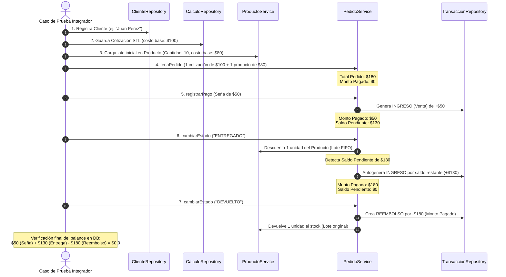

# 🧪 Suite de Pruebas Automatizadas (Testing Suite)

Este documento detalla qué componentes y lógica de negocio están cubiertos por la suite de pruebas de **PrintRM**, además de describir el flujo integrador de punta a punta que simula el ciclo de vida comercial y financiero de la aplicación.

---

## 🚀 1. Comandos de Ejecución Rápidos

### Backend (Gradle + JUnit 5)
```powershell
# Ejecutar todas las pruebas de integración
./gradlew :backend:test

# Compilar los archivos de prueba para verificar sintaxis y tipos
./gradlew :backend:compileTestJava
```

### Frontend (Vite + Vitest)
```powershell
# Ejecutar pruebas unitarias en modo interactivo (watch mode)
npm run test

# Correr pruebas una sola vez (modo CI/CD)
npx vitest run
```

---

## 🔍 2. Qué cosas tenemos testeadas (Cobertura de Lógica de Negocio)

La suite de pruebas automatizadas garantiza la robustez del sistema frente a escenarios financieros disruptivos o flujos de inventario complejos:

### A. Gestión de Inventario (FIFO por Lotes)
*   **Fusión de Lotes (Cost-Tiered)**: Si se ingresa stock nuevo con un costo unitario similar a un lote activo existente (diferencia < `0.01`), el sistema no duplica el lote, sino que fusiona las cantidades del lote existente.
*   **Consumo Secuencial (FIFO)**: Al vender o entregar piezas, el sistema consume secuencialmente la cantidad actual de los lotes activos ordenados por antigüedad (fecha de creación ascendente).
*   **Cascada de Stock**: Si un lote se agota a mitad de un pedido, el consumo continúa en el siguiente lote más antiguo.
*   **Límite de Stock**: Se verifica que se lance una excepción si se intenta consumir más stock del disponible.

### B. Finanzas, Señas y Devoluciones
*   **Devolución y Reembolso**: Comprobación de que cambiar un pedido a estado `DEVUELTO` genere una transacción de tipo `REEMBOLSO` con monto negativo que anule la venta.
*   **Consistencia de Balance**: Valida que después de una venta y una posterior devolución, el balance final neto sea exactamente `$0.0`.
*   **Blindaje de Reembolsos (Señas)**: Valida que el reembolso generado en pedidos con pago parcial (seña) sea igual a `montoPagado` y nunca al `total` teórico del pedido.

### C. Idempotencia y Mermas (Seguridad Contable)
*   **Evitar Doble Gasto de Producción**: Valida que cambiar reiteradamente el estado de un pedido a `EN_PRODUCCION` no genere transacciones de egreso duplicadas (idempotencia).
*   **Reclasificación de Mermas**: Comprueba que al registrar unidades fallidas de un ítem, el balance financiero neto no sufra un doble descuento. Se verifica la generación de dos movimientos compensados: un egreso adicional por `MATERIAL` y un egreso compensatorio por `MERMA` de valor negativo, dejando la pérdida asentada a nivel estadístico.

### D. Ciclo de Vida del Pedido y CRUDs
*   **Recálculo de Pedidos**: Valida que al modificar cantidades de un ítem de pedido, el total general se recalcule dinámicamente en caliente.
*   **Cancelación**: El pedido cambia a estado `CANCELADO` pero preserva su total para registros históricos.
*   **CRUDs de Entidades**: Cobertura completa de la persistencia e integridad referencial de `Clientes`, `Ajustes`, `PiezaSTL`, `FilamentProfile`, `Perfil` (impresora) y `PrintProfile` (ajuste de impresión).

### E. Fórmulas Financieras en el Frontend
*   **Math Check**: Valida en el frontend que el cálculo de energía consumida, filamento utilizado en gramos y desgaste de repuestos por hora correspondan con precisión matemática a los valores ingresados.

---

## 🔄 3. Descripción del Flujo Integrador

Para probar la interacción de todos los módulos bajo un escenario real de negocio, la suite de tests simula el siguiente flujo de integración de punta a punta:



Este flujo garantiza que la API de pedidos, el motor de transacciones contables del Libro Diario y el stock por lotes mantengan una integridad absoluta de datos en cada transición de estado de la aplicación.
